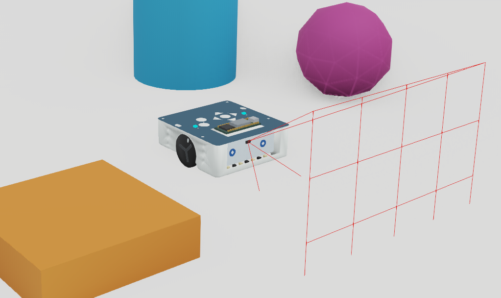
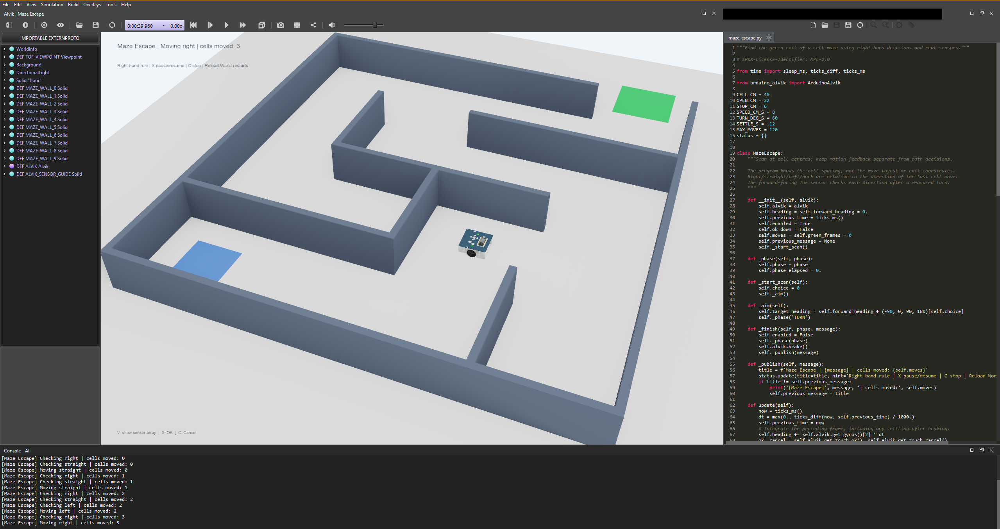

# Alvik Simulation

**Run Arduino Alvik Python code directly in Webots.**

Use the familiar Alvik MicroPython API to test robot behavior in simulation without a physical robot. The Alvik bridge connects supported API calls to simulated motors and sensors, so compatible programs can keep the same robot logic.



## Purpose and scope

Develop and explore Alvik programs in software, then carry the robot logic over to a physical Alvik using Arduino's library. The examples use public Alvik methods for driving, sensing, LEDs, and touch input. Scene placement, visual overlays, and repeatable world resets are handled by Webots tools outside those robot algorithms.

The current adapter covers a subset of the API. Full compatibility with every Alvik program is still a development goal; unsupported APIs and MicroPython-specific dependencies require additional implementation.

## How the Alvik bridge works

On a physical robot, `from arduino_alvik import ArduinoAlvik` loads Arduino's MicroPython library. In this project, the bridge supplies that module inside Webots' Python controller process. It translates API calls into Webots device operations: wheel speeds become motor commands, sensor methods read simulated devices, and timing calls advance simulation time.

```text
  Your Alvik program          Alvik bridge               Webots model
+--------------------+   +----------------------+   +--------------------+
| Python robot logic |-->| Alvik API -> devices |-->| Motors and physics |
| robot_code/*.py    |<--| Sensor values        |<--| Simulated sensors  |
+--------------------+   +----------------------+   +--------------------+
                         arduino_alvik.py
```

Commands travel to the right; sensor feedback returns to the left. The program and bridge run in the same Python process inside Webots.

The bridge runs compatible Python source under CPython. It does not translate source code into another language or run the ESP32/STM32 firmware. Programs using the implemented API and supported Python features can keep their robot logic; unsupported APIs, external hardware, or MicroPython-specific modules need additional implementation.

## API compatibility

| Area | Current support |
| --- | --- |
| Motion and odometry | Wheel speeds and positions, linear/angular drive, blocking `move` and `rotate`, pose read/reset. |
| Sensing | Three line readings, five horizontal ToF readings plus top/bottom, RGB/HSV colour, accelerometer and gyro tuples. |
| Input and output | Touch polling, left/right RGB LEDs with on/off colour channels. |
| Timing | `time.sleep`, `sleep_ms`, `time.time`, and MicroPython tick helpers use simulation time. |
| Not implemented | Servo and individual-wheel control objects, fused orientation and motion gestures, battery/charging telemetry, event callbacks/timers, raw hardware colour readings, firmware/communication management, and nonblocking target motion. |

The [API compatibility reference](docs/api-compatibility.md) lists every public Alvik method, whether it is implemented, whether the examples use it, and the remaining limitations. A supported method can still have limits on units or options; method coverage alone does not establish hardware equivalence.

## Requirements

- Webots R2025a
- Python 3 configured in Webots; the reference setup uses CPython 3.15.2 on Windows

The examples use Python's standard library and Webots' bundled controller library. No physical robot or separate Alvik library installation is required. Other operating systems and Python versions have not been validated for this release.

## Quick start

All file paths below are relative to the extracted repository folder.

1. Download the repository with **Code > Download ZIP**, then extract it. Keep the folder structure intact.
2. Open `worlds/black_line.wbt` in Webots.
3. Start the simulation if it is paused. Click the 3D view to give it keyboard focus.
4. Press **X** to pause or resume the robot; **C** stops it. Use **Reload World** for a fresh run.

Press **V** in any world to show or hide the sensor array and live distance readings. They start hidden. No controller flag or extra world object is needed.

A small on-screen hint shows **V: show/hide sensor array | X: OK | C: Cancel** in every world. Each program defines what its OK and Cancel inputs do.

If the controller does not start, set **Tools > Preferences > General > Python command** to your Python executable. For manual driving and editable obstacles, open `worlds/playground.wbt`.

## Create a map

Start with the [Blank Template world](worlds/blank_template.wbt) in the repository's `worlds/` folder. Open `worlds/blank_template.wbt` in Webots to load the arena and open `robot_code/blank_template.py` in the Text Editor.

1. Open `worlds/textures/blank_template.png` in Paint or another image editor. Draw lines, colour patches, or other floor markings. Keep the image dimensions.
2. Save the PNG and reload the world in Webots to see your painted floor. Write your robot behavior in `robot_code/blank_template.py` and save to run it.
3. To keep a separate project example, use **Save As** for a new PNG such as `my_course.png`, then copy the template world and Python starter under the same name. Point the copied world at those files. The [custom-world guide](docs/usage.md#create-a-custom-track) gives the exact names and settings.

PNG edits change the floor markings. For solid obstacles, drag spare 3D props from the side. Press **1–4** in the 3D view for an empty floor, boundaries, a centre obstacle, or a maze.

Worlds, programs, and floor textures share the same name: for example, `worlds/black_line.wbt`, `robot_code/black_line.py`, and `worlds/textures/black_line.png`. Each example has its own texture, so editing one does not alter another.

## Included examples

The included programs demonstrate capabilities such as:

| World | Behavior |
| --- | --- |
| [Blank Template](worlds/blank_template.wbt) | Write your own Alvik code on a clear floor; choose scene presets and drag in props. |
| [Maze Escape](worlds/maze_escape.wbt) | Check passages with the forward sensor, follow the right-hand rule, and stop on the green exit pad. |
| [Central Routes](worlds/central_routes.wbt) | Find a selected colour at a junction, follow its route, and return to Central. |
| [Obstacle Avoidance](worlds/obstacle_avoidance.wbt) | Leave the tape, pass a block, and rejoin the line. |
| [Robot Playground](worlds/playground.wbt) | Switch between autonomous exploration and manual driving; drag in props and reload code in place. |
| [Sensor Motion](worlds/sensor_motion.wbt) | Experiment with LEDs, distance sensing, wheel odometry, and obstacle detours. |
| [Line Recovery](worlds/line_recovery.wbt) | Compare steering gains and recover the track after a short gap. |

Each program prints a short description of its behavior and its controls when it starts. The [user guide](docs/usage.md) contains the full world catalog and operating instructions.

### Maze Escape in Webots



Maze Escape with live program status alongside its Python code.

## Controls

| Key | Action |
| --- | --- |
| **X** | Alvik OK: start, pause, or resume, depending on the program state. |
| **C** | Alvik Cancel: stop; select destinations or modes while stopped in the relevant examples. |
| **W/A/S/D** | Directional touch pads; manual driving or experiment selection. |
| **F** | Centre touch pad; reset the sensor and control experiments. |
| **V** | Show/hide the sensor guide and live distance array in every world; hidden initially. |
| **J / K** | Move the target nearer or farther in the Hand Follower world. |
| **U** | Rerun the active Python program in Playground or Blank Template. Saving also reloads it. |

Autonomous examples begin when the simulation runs and sensor data is ready. Route selection and configurable experiments wait for input. See the [user guide](docs/usage.md) for each world's exact controls.

## Project structure

| Folder or file | Purpose |
| --- | --- |
| [controllers/arduino_alvik/](controllers/arduino_alvik/README.md) | Shared Python API bridge, visual displays, and scene tools. |
| [robot_code/](robot_code/README.md) | Standalone Alvik example programs with a brief catalog. |
| [protos/](protos/README.md) | Robot model, simulated devices, and visual meshes. |
| [worlds/](worlds/README.md) | Example scenes, floor textures, and Webots editor settings. |
| [docs/](docs/README.md) | Setup, controls, custom maps, API coverage, and model notes. |
| [LICENSES/](LICENSES/README.md) | License references for software and model assets. |
| [.gitignore](.gitignore) | Excludes local caches, backups, and editor artifacts from version control. |
| [.gitattributes](.gitattributes) | Sets text line endings and marks PNG images as binary. |
| [LICENSE](LICENSE) | Standard Mozilla Public License 2.0 terms for the software. |
| [THIRD_PARTY_NOTICES.md](THIRD_PARTY_NOTICES.md) | Upstream sources, retained notices, and adaptation details. |

Open `.wbt` files to run worlds. The adjacent `.<name>.wbproj` files preserve Webots editor layouts and open the matching Python program; keep them with their worlds. The [world catalog](worlds/README.md) describes each scene and its supporting files.

To run your own program, add a `.py` file under `robot_code/`, select the Alvik node in Webots' Scene Tree, and set its first `controllerArgs` entry to that filename. Keep `controller` set to `arduino_alvik`. The [user guide](docs/usage.md#run-your-own-named-python-file) includes an example and instructions for editing tracks and playground props.

Keep a short `sleep_ms` or `sleep` in polling loops so Webots can advance physics and refresh its sensors. Use the physical robot's official library when transferring the same program to Alvik. Sensor thresholds, calibration, and motion settings still need checking on the real robot.

All controller-side Python lives in `controllers/arduino_alvik/arduino_alvik.py`, including keyboard shortcuts, scene presets, displays, and code reload. Its opening comments explain the code sections and every controller argument. Files under `robot_code/` contain the individual Alvik programs. See the [controller argument reference](docs/usage.md#controller-arguments) for the available scene tools.

The supported feature flags `--beams`, `--status`, `--hand-target`, and `--lab` can be combined with any robot program. The bridge creates missing guides and requested target or exercise objects. `--beams` remains accepted for compatibility; **V** works without it. Standalone scene-helper modes are handled separately by the supplied editable worlds.

## Simulation scope

The model represents differential drive, wheel encoders, three line sensors, one downward RGB sensor, one front depth sensor, an accelerometer and gyroscope, two RGB LEDs, and keyboard touch controls. The adapter uses simulation time and converts Alvik-style commands to Webots device calls.

The front sensor renders a 4 x 4 depth matrix and groups it into the Alvik firmware's five horizontal and three vertical outputs, sharing the centre reading. Optical response, friction, mechanical dimensions, and timing include approximations. The simulation has not been calibrated against a physical Alvik. See [model and API details](docs/usage.md#how-the-bridge-works).

Wheel motors use Webots' standard rotational-motor sound, with pitch and volume following their speed. Adjust or mute it with Webots' own audio control. This is a simulation cue, not a recording of the physical Alvik.

## License

Software is distributed under [MPL-2.0](LICENSE). Model assets use CC BY-SA 4.0. See [third-party sources and notices](THIRD_PARTY_NOTICES.md) for credits, upstream licenses, and their scope.
